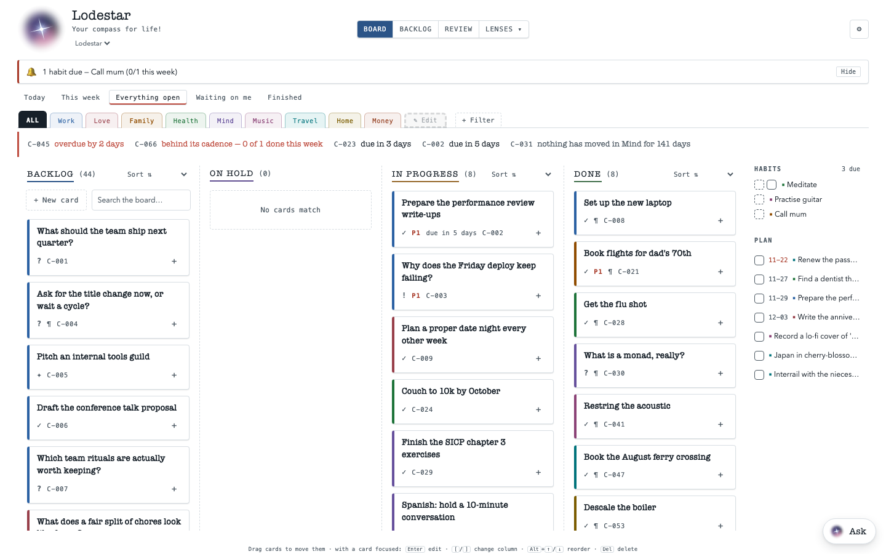
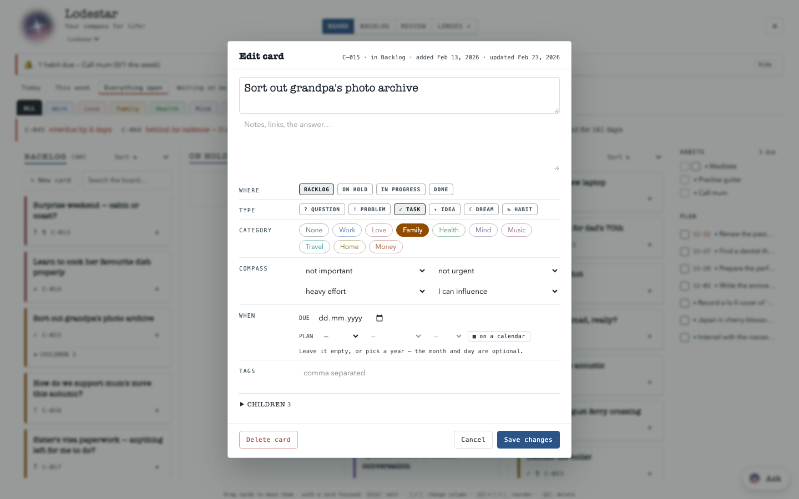
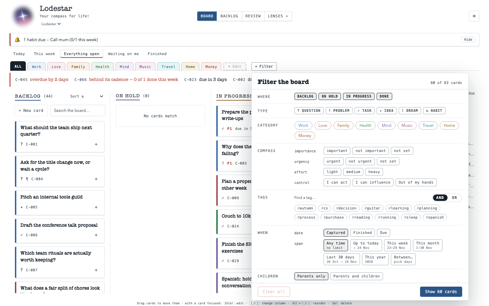
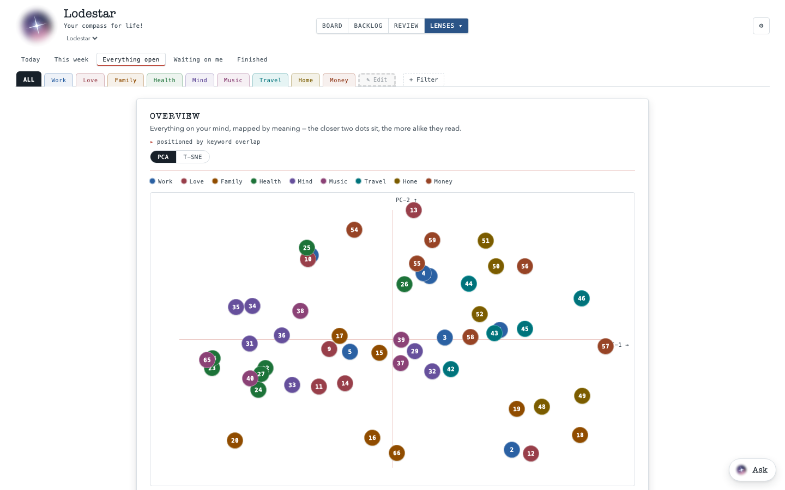
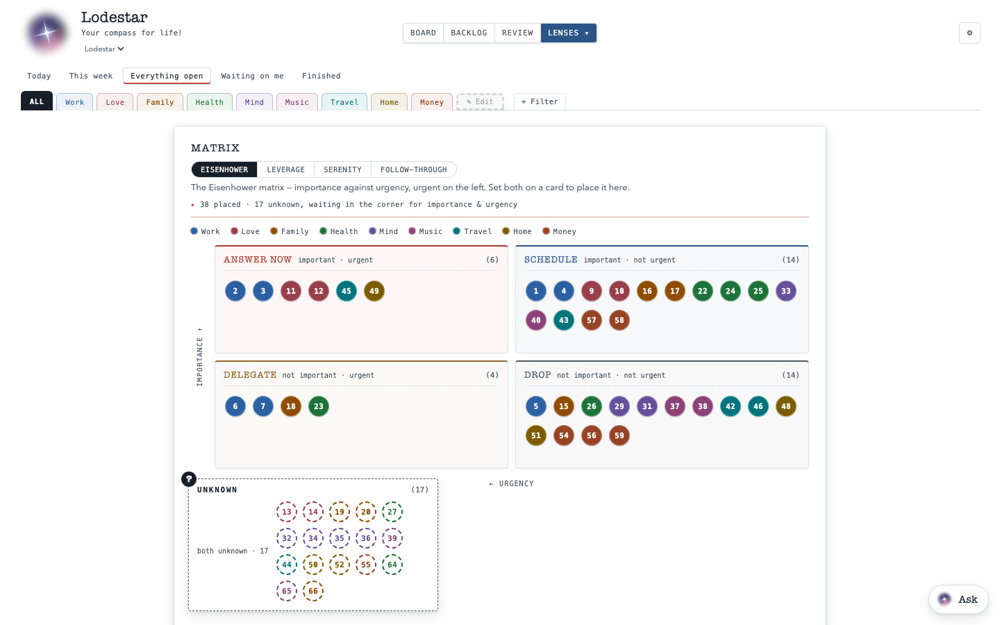
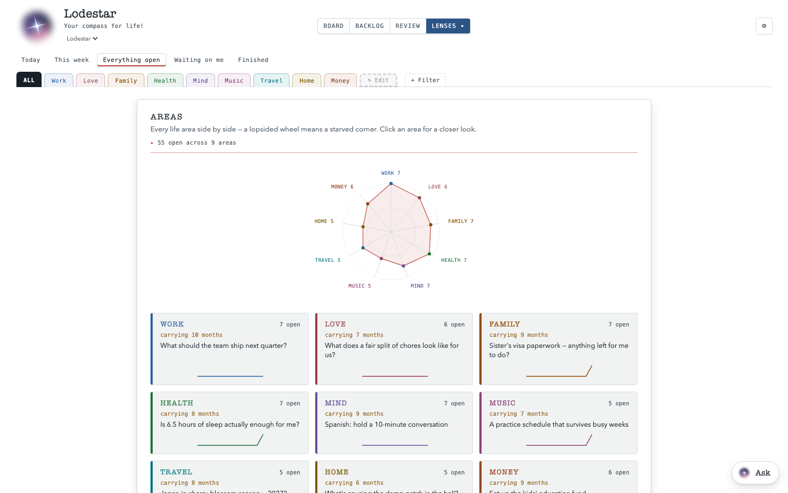
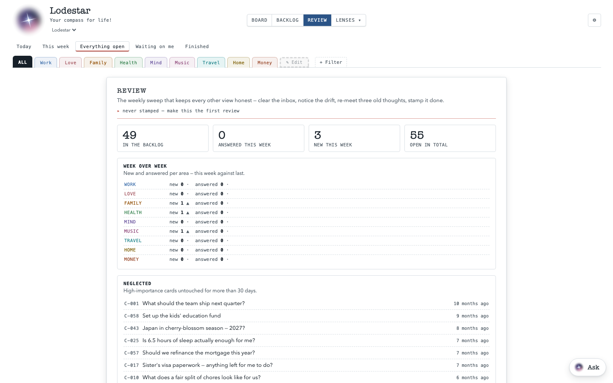
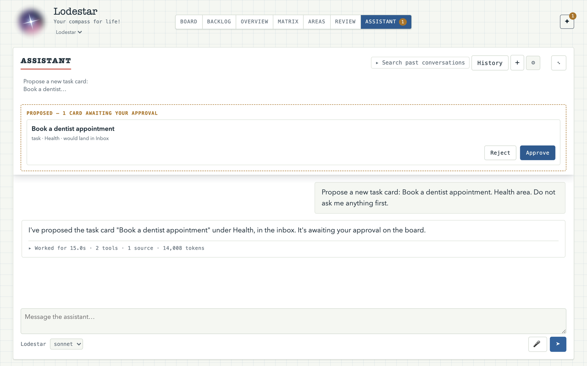
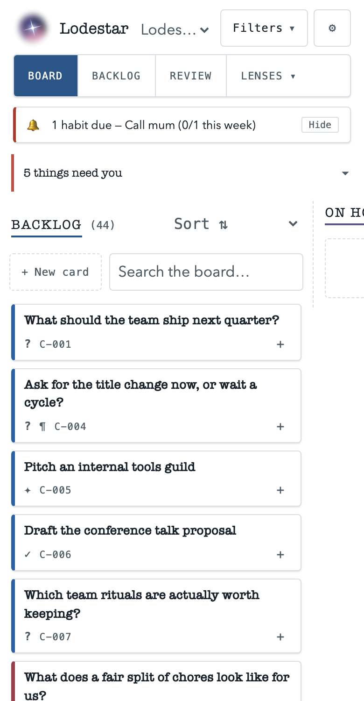
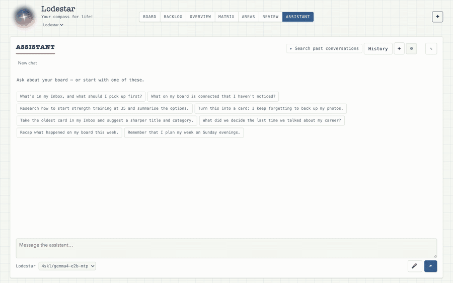

<div align="center">

# ✦ Lodestar

**A local-first board for everything on your mind — work, love, family, health, money and the rest.**

Questions, tasks, ideas, dreams and habits in one place, on your own machine,<br>
with an optional AI assistant that proposes changes and never makes them on its own.

[](https://github.com/S-Moha-M-Kashani/lodestar/actions/workflows/ci.yml?query=branch%3Amaster)
[](LICENSE)
[](package.json)
[](brain/pyproject.toml)

[Features](#features) · [Quick start](#quick-start) · [Screenshots](#screenshots) · [Architecture](#architecture) · [Contributing](#contributing)

</div>



## Why Lodestar

Most planning tools are built for work: projects, sprints, tickets. Real life is not shaped like
that. *"Should we move to another city?"* is a question, not a task. *"See Japan in 2027"* is a
dream. *"Meditate twice a day"* never finishes.

Lodestar gives each of those a home, keeps them on your own computer, and tells you each day
which few deserve your attention.

## Features

- **Six kinds of card** — question, problem, task, idea, dream and habit.
- **Life areas, not projects** — nine colour-coded areas out of the box; rename, recolour or add your own.
- **A daily summary line** — overdue cards, habits falling behind, plans due now, areas gone quiet.
- **Habits** — "twice a day" or "every Sunday at 10", with a punch strip and a history.
- **Deadlines and plans** — *when it's due* and *when you mean to do it*, from "2027" down to a day.
- **Cards with parts** — break a big card into smaller ones.
- **Filters and lenses** — one-click views (*Today*, *This week*, *Waiting on me*, *Finished*) and a filter window for type, area, priority, tags and dates.
- **Other views** — a meaning map, an Eisenhower matrix, a life-area radar and a weekly review.
- **Several boards** — e.g. a shared one for a household and a private one for yourself.
- **Works on a phone** — installable to the home screen, no separate app.
- **AI assistant (optional)** — ask in plain language or by voice. It can search and *propose* cards or edits; nothing changes until you approve. Runs on a local model (Ollama), your Claude or ChatGPT subscription, or OpenRouter.
- **MCP server** — use the board from Claude Code, Claude Desktop or any MCP client.

**Private by design:** one SQLite file on your machine, no account, no cloud, no telemetry.
Password-protected and loopback-only by default. Deleting a card takes two deliberate steps,
every change can be undone, and the database backs itself up. See [`SECURITY.md`](SECURITY.md).

## Quick start

**Board only** — needs [Node.js 23.4+](https://nodejs.org). No `npm install`, no build step.

```sh
git clone https://github.com/S-Moha-M-Kashani/lodestar.git
cd lodestar
npm run auth:setup   # choose a password; paste the printed line into .env
npm start            # open http://localhost:3000
```

**Board + AI assistant** — needs [Docker](https://docs.docker.com/get-docker/).

```sh
cp .env.example .env   # then run `npm run auth:setup` and paste its line into .env
docker compose up --build
```

The assistant uses your Claude subscription by default: put the token from `claude setup-token`
in `.env` as `CLAUDE_CODE_OAUTH_TOKEN`. Other engines, phone access and every setting are
documented in [`.env.example`](.env.example),
[`docs/cli-backends.md`](docs/cli-backends.md) and [`docs/security.md`](docs/security.md).

<details>
<summary><b>Run the assistant without Docker</b></summary>

Needs [uv](https://docs.astral.sh/uv/).

```sh
set -a; . ./.env; set +a   # uvicorn does not read .env on its own
uv run --project brain --extra local-embeddings uvicorn lodestar_brain.server:app --port 9000
```

Choose the model with `BRAIN_LLM`: `ollama` (default), `claude-cli`, `codex-cli`, or
`openrouter` (with `OPENROUTER_API_KEY`). Use `BRAIN_EMBEDDER=fake` to skip the ~1 GB
embedding model.

</details>

<details>
<summary><b>Use the board from an MCP client</b></summary>

```sh
npm start      # the board
npm run mcp    # the MCP server, on stdio
```

Claude Code picks it up from `.mcp.json`. For Claude Desktop:

```json
{
  "mcpServers": {
    "lodestar": {
      "command": "node",
      "args": ["/absolute/path/to/lodestar/mcp/server.mjs"],
      "env": { "LODESTAR_BOARD_URL": "http://127.0.0.1:3000" }
    }
  }
}
```

Tools: `describe_board`, `list_cards`, `get_card`, `create_card`, `update_card`,
`delete_card` (moves to Trash), `list_trash`, `restore_card`.

</details>

## Screenshots

All screenshots show the bundled demo data ([`sample-overview.json`](sample-overview.json)).

| | |
| --- | --- |
|  **Card editor** — every property on one page. |  **Filters** — every row takes several answers. |
|  **Overview** — cards mapped by meaning. |  **Matrix** — importance against urgency. |
|  **Areas** — a lopsided wheel shows a neglected corner. |  **Weekly review** — what moved and what was forgotten. |
|  **Assistant** — proposals wait for your approval. |  <br> **Phone** — same app, narrowed. |

<details>
<summary><b>The approval flow in 15 seconds</b></summary>



</details>

## Architecture

```
browser ──▶ board server :3000 ──▶ assistant "brain" :9000 ──▶ Chroma :8003
vanilla JS   Node + SQLite          Python, LangGraph           chat memory
no build     one dependency         one agent, three tools      (optional)
```

- **Frontend:** native ES modules, no framework, no bundler.
- **Server:** `node:http` + `node:sqlite`; the board works fully without the assistant.
- **Assistant:** a LangGraph agent with hybrid search (dense + BM25 + reranking). It can read
  and propose, but has no tool that writes or deletes on its own.
- **Swappable backends:** chat model, embedder, reranker and speech-to-text are each chosen by
  an environment variable; an unknown value stops startup instead of silently falling back.

More detail: [`ARCHITECTURE.md`](ARCHITECTURE.md) · design records in
[`docs/decisions/`](docs/decisions/) · release notes in [`CHANGELOG.md`](CHANGELOG.md).

## Contributing

Contributions are welcome — bug reports, fixes, docs and new ideas. Read
[`CONTRIBUTING.md`](CONTRIBUTING.md) for setup and conventions. In short:

```sh
node --test tests/*.test.js                         # server tests
uv run --project brain pytest brain/tests           # assistant tests (offline)
uv run --with playwright python tests/e2e_test.py   # end-to-end browser tests
```

Please report security issues privately, as described in [`SECURITY.md`](SECURITY.md).

## License

[MIT](LICENSE) © 2026 Moha Kashani
